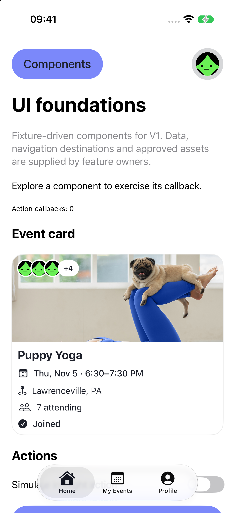
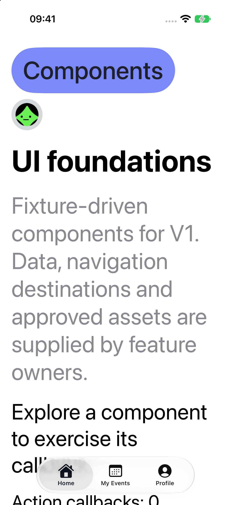

# UI foundations review — October 29, 2026

Implementation is a review candidate on feature/ui-foundations, tracked in [issue #2](https://github.com/dip-app/app/issues/2). It supplies presentation APIs, not completed V1 product workflows.

## Inspected references

Figma file DCIagJo7uk5IOUGqlKzAjf, session be39ee55-d9c7-4f0a-9060-c6a86dbffcc7. Full design context and screenshot were inspected for Header 46:276, Event Card 46:1162, Avatar 168:2951 and Home Navigation 46:668. Event Page 46:1397 supplied the Join action references (46:2091 and 46:1410). Loading/empty/error UI has no supplied Figma frame; native ProgressView/ContentUnavailableView is a proposed foundation for review.

## Intentional adaptations

- Use native TabView for safe areas, accessible selected state and visible labels. V1 exposes Home, My Events (calendar) and Profile; rewards/notifications are not exposed without an available feature action.
- Put title/date/location/attendance/joined metadata on an opaque readable card surface rather than small text over photography. The whole card is one details action; it does not add a duplicate Join button.
- Use the existing ink-on-purple semantic token proposal for readable small text. Preserve the observed purple, rounded cards and pills. Use system Dynamic Type fonts while custom font assets remain unapproved.
- Use caller-supplied already-loaded Image values and explicit loading/missing/failed states; the design system does not fetch data or own image authorization. Native SF Symbols are an explicit platform adaptation, not a claim that Figma Heroicons were imported.
- At accessibility sizes, stack header content and constrain images/gallery content to the available width. Visual review caught horizontal overflow and the fix is included. An initial accessibility grouping on the card also lost native button identity; simulator tests caught and verified the correction.

## Evidence and remaining review

Xcode27/iOS27 iPhone17 Pro simulator: design-system package tests and simulator interaction tests were run. The real DIP target builds after excluding Markdown from app resources; this small integrator patch fixes duplicate README output names present in the initial project scaffold. The final component revision was visually reviewed at standard and Accessibility 3 text sizes. The latter verifies header reflow and horizontal containment; the scrollable card/actions are also exercised by the simulator suite. No fonts or raw Figma image files are committed; the reference-input screenshot uses Figma media only as locally supplied review data.

Manual VoiceOver traversal, Increase Contrast, RTL, physical-device behavior, custom font registration and approved default-image assets still need design/frontend review. Dark mode has not been implemented or claimed. Native selected-tab behavior and accessibility labels/values are exercised by XCTest, which is narrower than a complete accessibility audit.

## Screenshots

